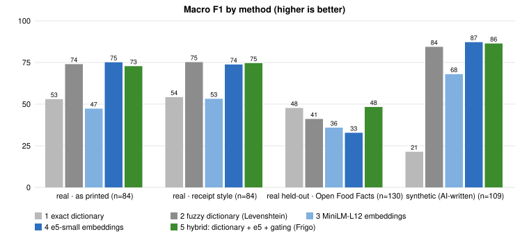
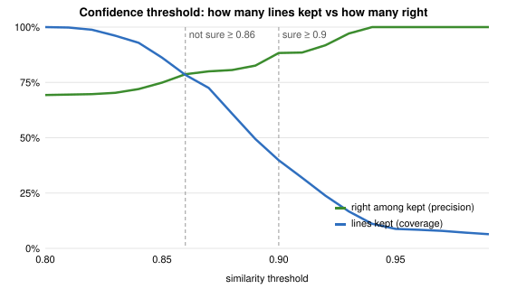
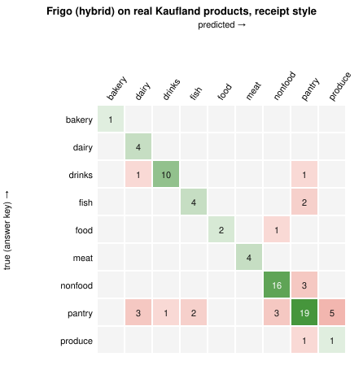
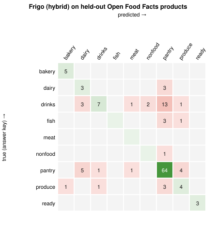
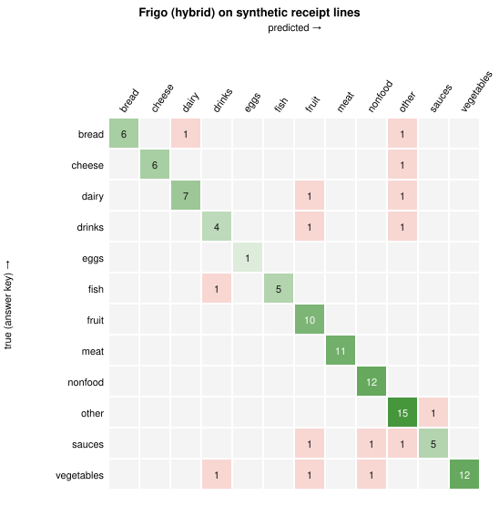

# Benchmark results — receipt categorisation (session 12)

Hypotheses fixed in advance in [`docs/HYPOTHESIS.md`](../HYPOTHESIS.md). Reproduce: `npm run benchmark` (Node, laptop) and
`npm run benchmark:browser` (in-browser speed, Chrome and Safari engines). Raw numbers: `results.json`.

## Test sets

| Set | n | Who labelled it | Role |
|---|---|---|---|
| **Real · Kaufland Moldova** (as printed, and in receipt style: UPPERCASE, no diacritics, 32 characters) | 84 | the shop (its own sections) | development: errors were analysed after version 1 |
| **Real · Open Food Facts, products sold in Moldova** | 130 | the Open Food Facts community | **held out**: never looked at while improving Frigo |
| Synthetic receipt lines | 109 | us (written by Claude) | development; not independent |

Methods: (1) exact dictionary of RO/RU stems, (2) fuzzy dictionary (Levenshtein, also comparing abbreviations with
word starts), (3) MiniLM-L12 embeddings, (4) e5-small embeddings, (5) **Frigo**: dictionary + e5 + confidence gating.
All embedding methods use the same product list and int8-compressed vectors, exactly as shipped to phones.

## Main result: macro F1 (0–100, higher is better)

| Method | Kaufland v1 (receipt style) | Kaufland v2 (receipt style) | **Held-out (Open Food Facts)** | Synthetic |
|---|---|---|---|---|
| 1 exact dictionary | 54.2 | 54.2 | 47.7 | 21.4 |
| 2 fuzzy dictionary | 48.3 | **75.2** | 41.1 | 84.4 |
| 3 MiniLM-L12 | 40.9 | 53.2 | 35.9 | 68.0 |
| 4 e5-small | 53.1 | 73.8 | 32.8 | 87.2 |
| 5 **Frigo hybrid** | 58.6 | 74.6 | **48.3** | 86.4 |

*v1 = 159 product types; v2 = 196 product types, after adding the missing kinds of product found in the v1 error
analysis (alcohol, canned fish, legumes, nuts, cleaning products, cosmetics). v2 helps the fuzzy dictionary and the AI
equally, because they share the product list.*

## Verdicts

| Hypothesis | Result | Verdict |
|---|---|---|
| **H1:** hybrid improves macro F1 by ≥ 20 points over the best string baseline, < 50 ms per line | Kaufland v2: 74.6 vs best baseline (fuzzy) 75.2 = **−0.6** (it is +20.4 vs the exact dictionary only). Held-out: 48.3 vs best baseline (exact) 47.7 = **+0.6**. Speed: 1.9 ms/line (Node), 12–14 ms/line (laptop browsers) | **Rejected** for accuracy (speed part holds on laptops; phones still to be measured) |
| **H2:** "sure" lines are right ≥ 90 % of the time, more than "not sure" lines | Synthetic 98.8 % · Kaufland 86.2 % · held-out **57.1 %** (and "sure" was *less* reliable than "not sure" there) | **Rejected** on real data |
| **H3:** model download ≤ 150 MB | 118 MB (+ ~1 MB product list) | **Confirmed** |

## What we learned

1. **Synthetic tests flattered the AI.** On lines we wrote ourselves the AI scored 86–88; on real products 48–75.
   We wrote those lines with the same words as the product list, so they were too easy. This is the main lesson.
2. **The product list matters more than the model.** Adding 37 missing product types raised every method by ~20
   points on Kaufland. A simple fuzzy dictionary with a good product list does as well as the AI.
3. **Where the AI still helps:** Russian ↔ Romanian ↔ English synonyms (`ЧЕСНОК` = `USTUROI` = garlic) and lines
   without any dictionary word (`ВЕТЧИНА ДОМАШНЯЯ` → ham). The real sets are almost all Romanian/English, so this
   strength barely shows there.
4. **Why the held-out set is hard:** most products are snacks and sweets with brand names (`Chio intense spicy cheese`
   is a snack, not cheese), so a food *word* in the name misleads both string matching and the AI. 75 of 130 products
   are "pantry", so the exact dictionary's default answer ("other") is often right by luck (67.7 % accuracy, but low F1).
5. **Confidence is not calibrated across data sources.** The 0.90 / 0.86 thresholds were tuned on synthetic lines;
   on real data the "sure" label is too optimistic. This is why the user always reviews every line, and it is the
   first thing to fix (see next steps).

## Threshold curve (justifying 0.86 and 0.90)

All sets together, e5 alone. Keeping only matches above 0.90 gives 88 % precision but covers 40 % of lines; 0.86
covers 78 % at 79 % precision. Frigo shows its guess above 0.86 and calls it "sure" above 0.90; below 0.86 it hides
the guess.

| Threshold | 0.80 | 0.84 | 0.86 | 0.88 | 0.90 | 0.92 | 0.95 |
|---|---|---|---|---|---|---|---|
| Lines kept (coverage) | 100 % | 92.9 % | 78.4 % | 60.9 % | 39.8 % | 23.8 % | 8.8 % |
| Right among kept (precision) | 69.3 % | 72.0 % | 78.7 % | 80.6 % | 88.3 % | 91.8 % | 100 % |

## Confusion matrices (Frigo hybrid)

Rows = right answer, columns = Frigo's answer; green = right, red = mistakes.

## Speed and memory

| Where | Model ready | Per line (one at a time) | Per line (whole receipt) | Memory |
|---|---|---|---|---|
| Node.js, MacBook (arm64) | 0.6 s from cache | 1.9 ms | 1.0 ms | +761 MB process RSS (includes ONNX Runtime) |
| Chrome engine, same laptop, phone screen | — | 11.9 ms | 13.9 ms | 11 MB page heap (model runs in a worker, not counted) |
| Safari engine (WebKit), same laptop | — | 12.6 ms | 14.3 ms | not reported by Safari |
| **Real phones** | *to measure: Settings → Receipt AI → speed test, then add the numbers here* | | | |

The fuzzy dictionary needs 0.5 ms per line and no download.

## Next steps (what a version 3 would test)

- Add the fuzzy dictionary to the hybrid (it was as good as the AI on Kaufland), and recalibrate the confidence
  thresholds on real data; then test on a **new** held-out set (e.g. `npm run collect:kaufland` again in a later week:
  offers change weekly, so new products are unseen).
- Real receipts (thermal paper, OCR errors) are still the missing test: the real sets here are clean product names.
